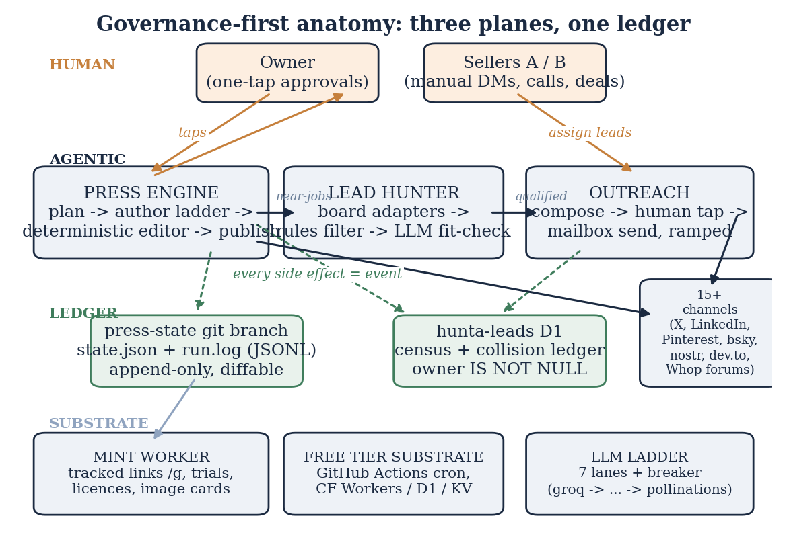
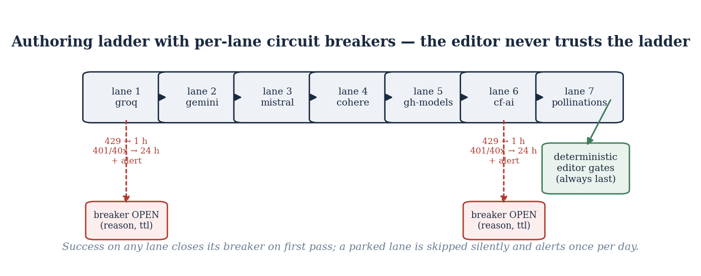
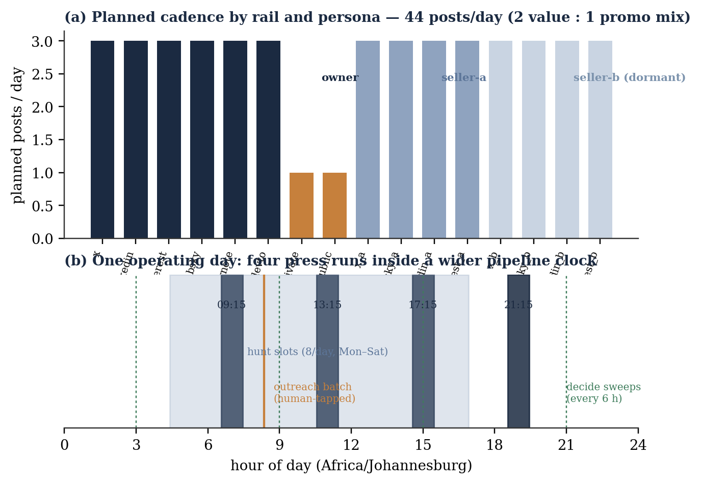
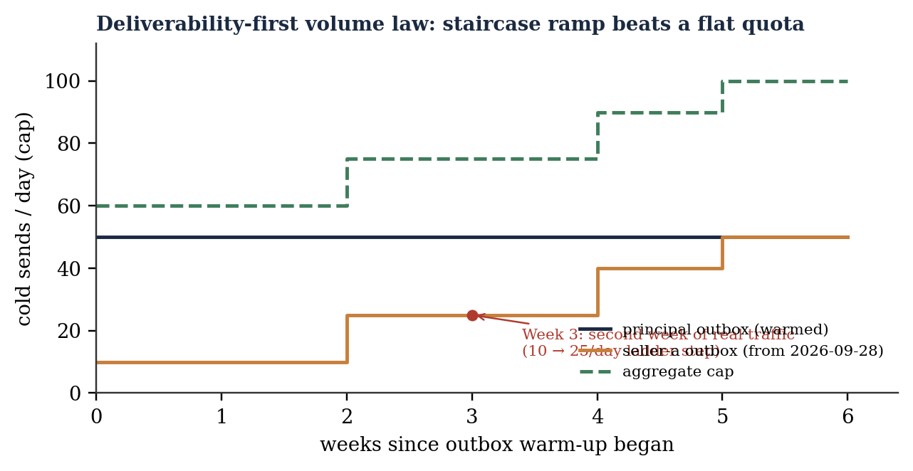
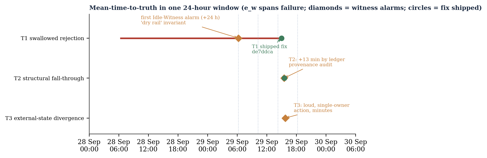
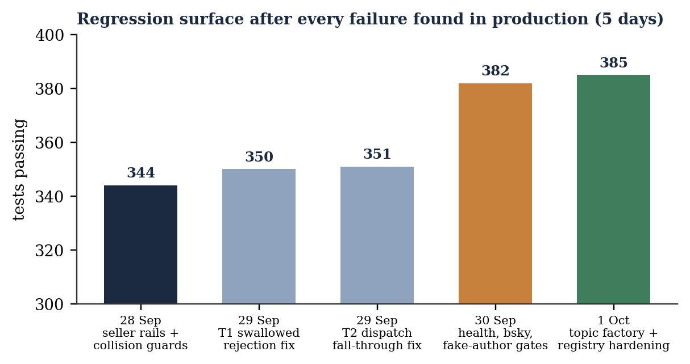
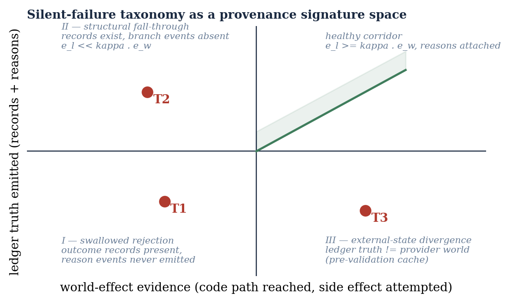

# Abstract

Frontier-class language models have pushed the marginal price of machine cognition toward zero, and the standard inference drawn from that collapse is that any connected individual now effectively owns a software company. The inference proves fragile in practice: producing content, code, or conversation is easy, while *operating* — posting on schedule, selling inside the law, never mailing the same prospect twice, and being able to state precisely what one's system did at three in the morning — remains stubbornly hard. This paper documents the design, deployment, and near-real-time failure forensics of **hunta**, a one-person, zero-capital sales and content business whose lead generation, cold outreach, multi-platform publishing, and marketplace distribution are executed by autonomous agents inside a strict governance architecture. The stack runs entirely on free infrastructure tiers — GitHub Actions for continuous compute, git branches as append-only ledgers, no-cost large language model (LLM) quotas arranged in a cascading provider ladder, a free social scheduler, direct Bluesky and nostr application programming interfaces (APIs), a paid-page marketplace, and standard Gmail simple mail transfer protocol (SMTP) accounts — and sustains a planned rhythm of 44 rail-posts per day across two human personas and fifteen channels, a verified census of 520 small-business prospects across three countries, and outbound batches that have so far attracted zero unsubscribe requests. The contribution, however, is the discipline rather than the stack. The work is published as the founding field report of the **Distributed Cognitive Autonomous Infrastructure (DCAI)** programme at Jacaranda Labs: the position that production-grade autonomy for small firms is an infrastructure problem before it is a model problem. The paper formalises four mechanisms: **Guarded-Capability Governance (GCG)**, a capability-granting model in which agents hold no infrastructure credentials and each granted capability is packaged together with an observer, a budget, and a revocation path; the **Ledgered-Agent Pattern (LAP)** and its read-only **Idle Witness**, an event journal coupled to an anomaly process that turns three empirically observed varieties of silent failure into detectable signature classes; the **Zero-Capital Ladder (ZCL)**, a five-rung substitution scheme mapping each conventional capital outlay to a free-tier reconfiguration; and **Effectuation-in-the-Loop (EIL)**, a tap-to-proceed gating pattern that parks automation at precisely the points where statutes or strategy, rather than technical capability, set the boundary. A silent-failure taxonomy extracted from live incident response — swallowed rejections, structural fall-throughs, and external-state divergences — is offered as reusable diagnostic vocabulary, with a small detection-time model bounding how quickly a ledger-plus-witness architecture converts such deaths into alarms. Mathematical formalisations, measurement tables, seven figures, and a 30-entry reference apparatus accompany the field report. The case is singular, recent, and coldly reproducible; its claims are architectural and audit-first.

**Keywords:** LLM agents; agentic AI governance; solo entrepreneurship; effectuation; bricolage; observability; GitOps; silent failure; digital labour; sub-Saharan business systems

# 1. Introduction

Three empirical observations converge in 2026. First, individuals in low-income economies can reach frontier-class language models at zero marginal cost through free application-programming tiers; the price that once separated a Harare desk from a multinational's research lab has effectively vanished for small workloads. Second, the fixed cost of trade-facing infrastructure — compute, persistence, distribution, even the acceptance of money — has fallen toward zero on free tiers, provided that one is willing to exchange money for configuration effort and to accept the quotas that providers attach to their generosity (see §6). Third, the entrepreneurship literature has long described exactly what resourceful people with intent but without capital do: they *effectuate* (Sarasvathy, 2001), beginning from the resources already in hand, pursuing affordable-loss experiments and stitching together partnerships; and they *bricolage* (Baker & Nelson, 2005), assembling functioning combinations from whatever material is already present.

What the literature does not yet contain is a field-grade account of what follows when the "what do I have?" inventory of effectuation comes to include **autonomous agents** that act — not occasionally, but several times a day, at machine tempo, under the founder's name. The practitioner discussion offered to such founders oscillates between two equally useless poles. One celebrates demo-ware ("my agent built a business overnight!") and evaporates the moment a validation gate rejects a draft; the other warns abstractly that agents will email the wrong person and get their owner sued, without specifying what working mitigation architecture would look like. Meanwhile, the research literature on LLM agents concentrates nearly all of its attention on *capability* — can the agent plan, remember, and use tools? (Xi et al., 2023; Wang et al., 2024) — and on *evaluation* of benchmarks (Yehudai et al., 2025), leaving the rather plainer question of *production custody* — who is watching the agent on a Tuesday, under quota strain, in a legal regime like South Africa's Protection of Personal Information Act (POPIA), Nigeria's NDPA, Zimbabwe's Cyber and Data Protection Act, or the CAN-SPAM gravity that follows every commercial mailbox — largely unaddressed. The observability community is arriving at the same gap from the infrastructure side: frameworks for post-deployment monitoring and debugging of agentic workflows are only now being proposed (Kartik et al., 2025), and production-grade deployment guides still describe observability as something the operator must bolt on rather than something the architecture should be.

This paper is a field report from the missing middle. It doubles as the founding field report of the Distributed Cognitive Autonomous Infrastructure programme — the claim, argued throughout, that trustworthy autonomy is infrastructure (credentials, budgets, observers, ledgers) before it is intelligence, and that this infrastructure must run on resources the smallest firm already has. The business, **hunta**, sells a concrete outcome to small African enterprises — it finds them clients and runs their demand-facing content, charging commission on deals that close. Inside it, agents plan and publish a 44-posts-per-day content program across two personas, crawl job boards into a lead census, compose and send batches of cold mail, and surface every click through a tracked-link worker. The operating posture is **governance-first**: the design claim is that generation is now abundant and therefore worthless as a moat, whereas *trustworthy autonomy* is scarce, and trustworthy autonomy is an engineering property — observers, budgets, revocation paths, ledgers — never a prompt property. In keeping with that posture, the report is unusually candid: it recounts not only what the system does, but what the system did *while it was wrong*, including three silent-failure incidents that occurred inside a single twenty-four-hour window in late September 2026, each quoted against verbatim ledger evidence.

**Contributions.** (1) A literal architecture (§4) and measured operation profile (§6) of a functioning zero-capital agentic business, offered as a reproducible pattern rather than a narrative. (2) Four governance mechanisms formalised in §5: Guarded-Capability Governance, the Ledgered-Agent Pattern with its Idle Witness, the Zero-Capital Ladder, and Effectuation-in-the-Loop. (3) A small but complete mathematical treatment of these mechanisms — capability tuples, evidence coverage, mean-time-to-truth bounds, an integer formulation of editorial cadence, and a decision-theoretic threshold for human gates — chosen so that other operators can evaluate the claims rather than admire them. (4) A three-class **silent-failure taxonomy** with provenance signatures and detection-time data (§7). (5) An analysis of compliance-as-architecture for multi-jurisdiction sub-Saharan selling (§8), suggesting that small firms will meet global regulatory regimes through code before they meet them through counsel.

**Reading map.** Section 2 situates the work; §3 fixes notation; §4 describes the anatomy; §5 is the formal core; §6 measures; §7 is the empirical heart; §8 handles law; §9 discusses implications and research agendas; §10 concedes threats to validity; §11 concludes.

# 2. Background and related work

## 2.1 Effectuation, bricolage, and the AI-age firm

Sarasvathy's (2001) contrast of causal rationality with the expert entrepreneur's effectual logic — bird-in-hand means, affordable-loss stakes, crazy-quilt partnering, leverage of contingencies, and pilot-in-the-plane control — has matured into a substantial program, including the decision-logic experimental work of Dew et al. (2009), the extension into marketing under uncertainty of Read et al. (2009), and the monograph treatment in Sarasvathy (2008). The bricolage line (Baker & Nelson, 2005) documents firms deliberately constructing from resources at hand, often in defiance of institutional expectations. Both traditions centre materially small firms in craft or developing-economy settings; both now confront a changed *content* of the means inventory.

The entrepreneurship-with-AI literature has begun to register this. Chalmers, MacKenzie and Carter (2021) map how AI reshapes the tasks of idea production, selling, and scaling, and warn of disintermediation risks for conventional small firms; the external-enablement framework (Davidsson, Recker & von Briel, 2020) generalises such shifts as environmental enablers of venture creation. Critically, Otis et al. (2024) deliver the first field-experimental evidence on generative AI and small-business performance: among 640 Kenyan entrepreneurs, a GPT-4-class assistant produced no average effect, yet materially lifted above-median performers and degraded below-median ones — an "uneven impact" driven less by the advice itself than by which advice was selected and executed. That finding is the closest existing evidence to the thesis of this paper: the binding constraint in AI-assisted small enterprise is not the intelligence but the *operating discipline* surrounding its selection, execution, and monitoring. A governance-first architecture is one way of industrialising the good selection that high performers display naturally.

## 2.2 LLM agents: from capability surveys to production custody

The survey literature on LLM-based autonomous agents is now broad: Xi et al. (2023) structure the construction and application of LLM agents; Wang et al. (2024) catalogue profile, memory, planning, and action modules; Guo et al. (2024) extend the census to multi-agent systems; Acharya, Kuppan and Divya (2025) review the agentic-AI goal-autonomy landscape. Framework practice — AutoGen's multi-agent conversation paradigm (Wu et al., 2023), Anthropic's practitioner guidance on building effective agents (Anthropic, 2024), and the evaluation literature evidenced by SWE-bench (Jimenez et al., 2024) and the evaluation survey of Yehudai et al. (2025) — is largely preoccupied with task success on benchmarks. The production-custody question — how a small operator *knows* daily what its agents did, and what happens when the answer is wrong — appears only at the edges: AgentCompass (2025) proposes post-deployment monitoring and debugging of agentic workflows, motivated by precisely the gap this paper attacks. The present work is complementary: rather than a monitoring *tool*, it describes a monitoring *architecture* purchasable at zero price, and provides an empirical silent-failure dataset from a running business.

Two design motifs in that corpus resonate here and are made rigorous in §5: *least privilege*, which GCG pushes to its commercial extreme (agents hold no credentials at all), and *human oversight*, treated in §5.4 not as residual compliance but as a throughput-protective architectural feature — consonant with Article 14 of the EU AI Act's (2024) requirement that human oversight capabilities be effective, and with the decision-quality evidence of Lebovitz, Lifshitz-Assaf and Levina (2022) on when professionals should and should not defer to machine judgment.

## 2.3 Observability, SRE, and the log as witness

The site reliability engineering tradition (Beyer et al., 2016) teaches that reliability is governed through cheap, honest proxies: error budgets, golden signals, and — most relevantly — the doctrine that *humans write logs because systems lie*. Oliner and Stearley (2007) showed across five supercomputers that the majority of major failures were preceded by anomalies visible in ordinary logs, and simultaneously that operators instrument chiefly for failure modes they already understand — an epistemic trap that the silent-failure taxonomy of §7 exploits and mitigates. Contemporary telemetry standards (the OpenTelemetry GenAI semantic conventions, 2024–) are formalising span-level tracing for model calls, but require SDK cooperation; the ledger approach here is deliberately cruder and more portable: a JSON-Lines file on a git branch, greppable with tools every practitioner already owns.

## 2.4 GitOps, the ledger as control, and auditability for the smallest firm

GitOps (Lim, 2017) designates a git repository as the system's source of truth, letting review, merge, and revert semantics drive operations. The ledger design in §4.2 pushes that pattern one trophic level downward: the only artifact agents may durably write is the ledger, and it is a branch. This yields, for a one-person firm, four properties that regulated-scale firms purchase from enterprise tooling: provenance (every event commit-stamped), diffability (state transitions are line-diffs), revertability (bad state is boringly un-writable-history), and external verifiability (the platform's commit graph is third-party corroboration). The ledgers of classical accounting and the audit chains of compliance practice are obvious ancestors; what is novel is their positioning as the *runtime control surface* of autonomous commercial behaviour.

## 2.5 Method: a revelatory single case

Following Yin (2018), the study is a single in-depth revelatory case — the unit of analysis is the governance architecture, embedded in one operator-business dyad. Evidence is compiled from artifacts (ledger records, continuous-integration telemetry, commit history, exact incident traces with commit identifiers), direct operation, and live probes of production state; data capture windows and measurement definitions are given in §6 and §7. Positionality deserves explicit statement: the researcher *built and operates* the system under study, and earns no salary from it yet — a stance unusual in agent research but closer to Schön's (1983) reflective practice and to the participant-inventor tradition of engineering research than to detached social science. The research is conducted inside the Distributed Cognitive Autonomous Infrastructure programme at Jacaranda Labs, where the author is the owner-operator of the system under study, and is funded by the Jacaranda Labs AI Think Tank. The compensating disciplines are pre-registered invariants (the ledger decides what counts as a failure before the narrative does), verbatim quoting of machine-produced evidence, adversarial self-auditing (dedicated audit sessions whose defect verdicts are also ledgered), and the threats-to-validity catalogue of §10.

# 3. Notation and theory preliminaries

Let $\mathcal{A}$ be the set of agent processes (press engine, lead hunter, outreach, reply engine), and let $\mathcal{R}$ be the set of output rails — channel–persona pairs such as $x$, $x_a$, $pinterest_a$. A *side effect* $e_w$ is an externally irreversible or costly-to-reverse action (a published post, a sent email, an assignment write). Every side-effect attempt is accompanied by one or more *ledger events* $e_l$; the ledger $L$ is the append-only sequence of all events, ordered by commit time. We write $E_w(t)$ and $E_l(t)$ for the sets of effects and events up to time $t$.

Three derived quantities recur. The **evidence coverage** of a subsystem is the ratio
$$\kappa(t) \;=\; \frac{|E_l(t)_{\text{provenance}}|}{|E_w(t)|},$$
where the numerator counts events carrying both a decision *and* an outcome *and* the server's own words when one exists. A healthy subsystem maintains $\kappa(t) \ge 1$ loosely (at least one full-signature event per effect); the signature algebra of §5.3 classifies failures by how $\kappa$ degrades. The **reason density** $\rho(t)$ counts, among failure-labeled events, the fraction carrying a verbatim external reason string. The **witness scan period** $w$ is the wall-clock interval between Idle-Witness invariant evaluations; in deployment $w$ equals the press-run cadence, nominally six hours across four runs.

# 4. Anatomy of the zero-capital agentic business

## 4.1 The three planes

Figure 1 shows the deployed anatomy: a **human plane** holding exactly five categories of judgment (approve, assign, connect, rotate, arbitrate), an **agentic plane** of three engines plus reply automation, and a **substrate plane** of free-tier infrastructure, with the **ledger** spanning agentic and substrate planes as the only durably-agents-writable artifact.



**Inventory.** One private code repository and one documentation repository; workflows for hunting (eight slots across four trigger times, six days weekly), decision/rendering (every six hours plus on-demand), outreach (one composed batch per weekday morning with re-send ticks), the press engine itself (four runs daily, seven days), a weekly topic-factory run (§4.4), continuous integration on every push, and dispatch-only chores (mailbox rotation, client provisioning). Cloudflare supplies the mint worker, the leads worker, two D1 databases, and image hosting. Two Buffer free organisations front six channels; Bluesky, nostr, and dev.to are addressed natively; Whop supplies the marketplace, its forums, and payments. Three Gmail accounts act as warmed outboxes (two active). Seven free LLM lanes form the authoring ladder (§4.3). Total monthly cost: **$0**.

## 4.2 The ledger, concretely

`press-state` is an ordinary git branch holding `state.json` (topic usage, per-rail counts, cooldowns, parked rails, LLM circuit-breaker entries) and `run.log`, a JSON-Lines event stream. Because the branch is CI substrate, agents write it through the platform contents API with read-modify-write rounds; every record is therefore timestamped, diffable, and revertable by ordinary git operations, and corroborated third-party by the host's commit graph. The choice is deliberately unglamorous — the standard forensic tool is `git log -p` — because auditability correlates strongly with boringness.

## 4.3 The authoring ladder and its circuit breakers

Copy is drafted by a seven-lane ladder (groq → gemini → mistral → cohere → github-models → cf-ai → pollinations), each lane guarded by a per-lane circuit breaker: quota rats (HTTP 429) park a lane for one hour; perished credentials (401/402/403/404) for twenty-four hours with exactly one health alert; three consecutive timeouts for one hour. First success on any pass re-closes the breaker. Figure 7 diagrams the arrangement, and §7 justifies empirically why the breaker is infrastructure and not decoration: lanes *do* perish in the middle of the content day, and perishing silently used to be how they perished.



## 4.4 The editorial loop and topic supply

Drafted copy faces a deterministic editor before any publish call: voice rules (the firm's brands avoid em- and en-dashes as fingerprint discipline), hype pattern bans (Financial-freedom vocabulary and absolutes), a facts registry consulted through placeholder substitution so that prices exist exactly once in source, a blanket ban on statistical-shape strings (any percent sign), length ceilings per channel, and per-kind structural requirements (promotions must carry a pointer link). A rejected draft is re-attempted once with the editor's exact complaint text injected as feedback, a repair loop added after incident T1-sequelae showed that silent rejection lists taught the model nothing. Topic supply for promotions is itself pipelined: a weekly workflow drafts candidate promo topics through the same ladder, and the gate that admits a topic into the registry is the repository's own test suite — schema shape, fuzzy near-duplicate matching, bans on invented or literal prices and stat shapes. The suite is, operationally, the editor-in-chief of the topic factory.

# 5. Four mechanisms, formalised

This section casts the four governance mechanisms into definitions and lightweight propositions. Nothing here exceeds undergraduate mathematics, by design: a governance claim a solo operator cannot compute is a governance claim the operator will not use.

## 5.1 The Zero-Capital Ladder (ZCL)

**Definition 1 (Ladder rung).** Let $\mathbb{E} = \{\text{compute}, \text{persistence}, \text{intelligence}, \text{distribution}, \text{capital-gate}\}$ be the conventional capital expenses of an internet business. A rung is a substitution map $f: \mathbb{E} \to \mathcal{F}$, where $\mathcal{F}$ is a set of free-tier reconfigurations, such that total monetary spend satisfies
$$C \;=\; \sum_{k \in \mathbb{E}} c(k) \;=\; 0,$$
and each rung $k$ carries a concession vector $(q_k, m_k)$ of binding quotas and maintenance burden, with the rung replaceable without disturbing the others.

**Definition 2 (Concession frontier).** For planned workload $W = (W_{\text{posts}}, W_{\text{hunts}}, W_{\text{sends}}, \dots)$, rung $k$ admits the workload iff $W_k \le q_k$; the firm is **ladder-feasible** iff $W \le q$ coordinate-wise. The concession frontier is the maximal $W$ under this constraint.

The instrument design treats the sequence $\{q_k\}$ as a *living budget*: §6 reports the observed values and, importantly, the breach plan is itself pre-committed (when continuous-integration minutes strain under the 44-post cadence, the plan is to cut *runs*, not *posts* — degrade scheduling granularity before volume, because the platform complexity is priced into the quota, not into marginal content). Table 1 restates the five rungs with observed concessions.

| Rung | Conventional price | Free-tier substitution | Concession observed in operation |
|---|---|---|---|
| Compute | VPS \$20–60/mo | CI free minutes, stateless crons | 20-minute job ceiling once killed a lead crawl at 20m13s |
| Persistence | managed DB | git-branch JSON + D1/KV free tiers | JSON merge races; D1 row quotas |
| Intelligence | LLM subscription | seven-lane ladder, per-lane breakers | probabilistic disobedience of declared budgets (incident class LP, §7.4) |
| Distribution | scheduler SaaS / ads | two free scheduler orgs; direct APIs | scheduler board-cache staleness (incident T3) |
| Capital gate | payment rails | marketplace paid page + manual settlement | commission bookkeeping stays human |

Table 1. The Zero-Capital Ladder with concessions actually encountered.

## 5.2 Guarded-Capability Governance (GCG)

**Definition 3 (Guarded capability).** A guarded capability is a quadruple $\gamma = \langle C, O, B, R \rangle$: $C$ the capability granted; $O$ an observer emitting provenance events to $L$; $B$ a budget (per-period count, size, cadence ceilings); and $R$ a revocation path whose actuation is $O(1)$ and whose effect is total.

**Proposition 1 (credential starvation).** Let $\Sigma$ be the set of secrets capable of moving money or impersonating humans. Under GCG as instantiated, for every agent $a \in \mathcal{A}$, $\text{Reach}(a) \cap \Sigma = \varnothing$.

*Justification.* All credentials in the deployment are injected by the continuous-integration scope at job start and never appear in the agents' addressable state (files it reads, environment it inherits beyond the job's own scope, or the ledger it writes). The two structural exceptions are scoped downward by construction: social credentials for publishing are per-channel and per-persona (spillage is bounded by the channel's own blast radius and is revocable at the provider), and mailbox app-passwords are sealed (symmetric encryption, key held outside the repo) with rotation producing fresh ciphertext in place. Hence no agent action — including prompt-injected ones — can reference material it does not possess. $\square$

The budget $B$ of each capability is stated as a vector over rails: per-rail daily caps $b_r$, cooldowns between publishes, promotion gap $g$ days, and a firm-wide value-to-promotion mix invariant $M \ge 2$ enforced on the rolling window. Revocation paths in production include per-rail parks (`rail_off` with expiry, actuated both by humans and by the anomaly machinery), secret deletion (a rail with missing credentials schedules nothing, by an *armed-rail* gate added retroactively after the health checker had noisily reported never-provisioned rails as failures), and workflow dispatch toggles. Every revocation is an event; the ledger therefore knows the times at which the system was told to stop.

## 5.3 The Ledgered-Agent Pattern and the Idle Witness

**Definition 4 (LAP).** A subsystem obeys the Ledgered-Agent Pattern iff every side-effect attempt $e_w$ is preceded and succeeded by ledger events $(e_l^{\text{pre}}, e_l^{\text{post}})$ carrying the decision hash, the outcome bit, and — on failure — the external party's own words. The ledger is the agent's only write-interface to truth.

**Definition 5 (Idle Witness).** A process with read-only ledger access that evaluates invariants on scan period $w$ and alerts, possessing no write path into production. Its false-alarm budget is deliberately bounded (at most one alert per firing rule per day) so it cannot be ignored to death.

Deployed invariants: *dry-rail* (a live-intent rail with attempts but zero landed effects across 48 h); *correlated failure* ($\ge\!3$ live failures in a day); *image-attachment regression*; *ratio* (the mix invariant $M$); *perished provider* (breaker-opened for $\ge\!20$ h on auth grounds); *configuration drift of prices* (divergence between the free tier's registry and the marketplace's own numbers).

**Proposition 2 (mean time to truth).** Consider a silent failure that starts at $t_0$.

(a) If the failure leaves at least one full-signature failure event per attempt (reason density $\rho = 1$), first-alarm delay satisfies $T_{\text{alarm}} \le w$ and, in the worst arrangement of scans, $\mathbb{E}[T_{\text{alarm}}] \le w/2$ beyond the first failing attempt.

(b) If the failure merely suppresses effects (an *absence* failure, observed only through the dry-rail window $W$), first-alarm delay satisfies $T_{\text{alarm}} \le W + w$.

*Sketch.* (a) The first failing attempt after $t_0$ emits a failure event with reason; the next witness scan spots a live failure and counts toward the correlated rule, or a human reader of the log sees it directly (this is the T3 experience: diagnosis within minutes of reason-bearing logs landing). (b) Absence failures are only inferable from the event stream once a full window $W$ of attempts has accumulated zero landings; the scan after the window closes fires. Both bounds were met in practice (§7): the absence-type T1 surfaced at approximately its 24 h window, and the reason-bearing T3 resolved in minutes. $\square$

The taxonomy used throughout classifies silent failure space $\mathbb{F}$ by provenance signature rather than by excuse:

| Class | Signature predicate | Canonical mechanism | First detector |
|---|---|---|---|
| T1 — swallowed rejection | $e_l^{\text{post}}$ exists, $\lnot$reason field, outcome false | failure returned to a branch that never logs its reason | dry-rail invariant + failure-without-reason probe |
| T2 — structural fall-through | records exist; *branch* events $= 0$, no exception | dispatch keyed on literal names where the domain is a family | record-versus-event cardinality mismatch |
| T3 — external-state divergence | $e_w$-consistent world mutated; repeated deterministic refusal *with* reason | provider cache/config drifting after local change | loud single-owner-actionable failure |

Figure 5 plots the three classes as regions of the provenance signature space; §7 supplies the empirical incidents.

## 5.4 Effectuation-in-the-Loop (EIL)

**Definition 6 (EL gate).** For action class $a$ with per-mistake harm $L(a)$, automaticity $p_{\mathrm{err}}(a)$, and human-gate cost $C_h$ per instance, the architecture automates $a$ iff $p_{\mathrm{err}}(a) \cdot L(a) \le C_h$, i.e.
$$L(a) \;\lesssim\; \frac{C_h}{p_{\mathrm{err}}(a)}.$$
Actions above the threshold are parked behind a one-tap gate.

Deployed instantiations: cold-mail batches (a deliverability or statutory mistake has $L$ priced at the mailbox or the account), direct messages to personal channels, lead ownership assignment (a wrong assignment poisons both seller motivation and engine dedupe), first-contact with a new jurisdiction (Nigeria sat behind a personal legal call under the NDPA), and person assignments to mailboxes. The halts are *feature boundaries*: their wall-clock cost is one tap and they fire at points where Sarasvathy's pilot-in-the-plane intuition has measurable economic content — the Otis et al. (2024) field results suggest the operator's gate value lies precisely in *selection* quality at such boundaries.

## 5.5 Editorial cadence as a small integer program

Formally, the daily plan solves: choose $x_{t,r,s} \in \{0,1\}$ (publish topic $t$ on rail $r$ in slot $s$) to maximise freshness-weighted exposure subject to
$$\sum_{t,s} x_{t,r,s} \le b_r \ \forall r; \qquad \sum_{s} x_{t,r,s} \le 1 \ \forall (t,r); \qquad \sum_{r,s} x_{t,r,s} \le 3 \ \forall t;$$
$$\text{promo}(t)\cdot x_{t,r,s} \ \Rightarrow\ \text{no promo on }t\ \text{within }g\text{ days}; \qquad \frac{|V|}{|P|} \ge M \ge 2 \ \text{on the rolling window.}$$

The deployed `due_this_cycle` is a greedy feasible scheduler over this constraint set (cardinality constraints make greedy non-regrettable within a day); the integer-program form matters for a different reason: it makes the *intent* checkable, so that when fed constraints drift (promo pool grows 9 → 39 and the freshness gap relaxes 2 → 3 days, as it did on 1 October 2026), the change is a one-line diff against a legible objective rather than a tuning superstition.

## 5.6 Deliverability as a ramp constraint

Mailbox warm-up is treated as a controlled step function $q_b(t) = 10 \cdot \mathbb{1}[t < w_1] + 25 \cdot \mathbb{1}[w_1 \le t < w_2] + \dots$ topping at 50 sends/day per outbox (Figure 3), with the aggregate $Q(t) = \sum_b q_b(t)$ budgeted into the batch composer. The comply-or-hold logic mirrors EIL: a mailbox that trips a provider challenge converts from an automatable asset into a held asset, human-resealable in about an hour. The staircase reflects deliverability economics rather than statute; §8 separates the two deliberately.

# 6. What the system does, measured

Measurements are windowed rather than impressionistic: each quantity cites its observation date (Africa/Johannesburg).

**Publishing program.** As of 29 September 2026 the cadence ledger recorded a full planned day — `x:2/2, linkedin:2/2, pinterest:2/2, bsky:2/2, nostrnote:1/1, whop_private:1/1, x_a:1/1, bsky_a:1/1, linkedin_a:1/1, …` — with seller-b rail zeros standing honestly in the stream (zeros are reportedness, not failure). Cumulatives: 127 published pieces across 39 distinct topics; value-to-promotion mix 34:8 against the then-current ≥4:1 self-rule. *Post-window directive (30 September):* the owner raised volume to three posts per platform per persona with a 2:1 value:promotion mix and seven-day scheduling; the planner now targets **44 rail-posts/day** (Figure 2), divided across the owner persona (6 × 3 socials plus 2 marketplace forums), seller-a (4 × 3), and seller-b (4 × 3, dormant pending account creation). A weekly long-form essay continues as an extra slot; short articles joined dev.to's daily line on 1 October.



**Demand program.** On 29 September: 520 verified prospects (ZA 454, ZW 36, ZM 30; Nigeria in gated rotation), outbound 25 sent / 5 queued / 20 skipped-by-rule, do-not-contact incidents zero; twenty of twenty-five duplicate-offer collisions blocked in the measured assignment window by the collision ledger. All sends originate from principal-domain mailboxes under the staircase of Figure 3.



**Economics.** $0 capital and operating spend excluding volunteer time. Shadow prices reveal where the ladder binds: continuous-integration minutes project ≈1,400/month for the press workflow alone against the platform's 2,000-minute private-repo ceiling — a ≈600-minute buffer, protected by the pre-committed breach plan (cut runs, not posts). LLM spending is structurally zero: seven no-cost lanes cover the day's ≈45–50 author calls with the breaker hysteresis described above.

**Test surface.** 351 suites passing on 29 September (press engine), 18 unit + 5 integration on the lead hunter; **385** by 1 October after the editorial hardening round described in §7.4 (Figure 6).

# 7. Three silent failures in one twenty-four-hour window

The empirical core. Production agentic systems die most dangerously in ways that *produce no exceptions — only absence*. The three incidents below, all within the seller-brand bring-up day of 28–29 September 2026, are quoted against verbatim ledger evidence; each survived code review and unit tests, and each was killed either by the witness or by the ledger's plain existence. Figure 4 summarises mean-time-to-truth; Figure 5 locates each class in the signature space of §5.3.



## 7.1 T1 — the swallowed rejection

**Symptom.** For a full day after seller-brand bring-up, the rails `x_a`, `bsky_a`, `linkedin_a`, `pinterest_a` published nothing, while every cycle exited *success*.

**Ledger evidence.** `run.log` carried validation rejections with exact measurements — `"linkedin_a: 1556 chars over 1200"`, `"x: 1338 over 450"`, `"bsky: 1436 over 300"` — followed by outcome records `ok=False` with **no reason field**. Two lies co-existed: models overshot declared budgets and the system swallowed the server's own words for what rejections survived validation.

**Root cause (compound).** (a) The authoring prompt named the rail (`linkedin_a`) but never stated its platform family or length ceiling, so the model composed LinkedIn-length prose for a 300-character Bluesky rail. (b) Publish-path serialisation failures — a Buffer response whose `__typename` was not `PostActionSuccess`, a Bluesky `createRecord` returning non-200 — returned a bare boolean `False` to a branch that logged nothing.

**Detection.** The dry-rail invariant fired at its window (+24 h from first attempt), and a published-history probe confirmed zero landings. Mean time to truth: bounded by the §5.3 (b) window, as predicted for absence-type failures.

**Fix.** The prompt now declares `platform: <family>; HARD LIMIT <n> characters — anything longer is auto-rejected; stay well under it`; every non-ok publish path logs `publish_error` carrying the server's message, capped; regression tests pin both behaviours. Commit `de7ddca`; suite 350.

**Alignment note.** Even post-fix the model overshot once (`1571 chars over 1200` on attempt 1) before the retry layer rescued the piece. Prompts attach *statistical* ceilings; validators attach *deterministic* ones. Governance architecture should therefore assume probabilistic model disobedience and defend at the wrist, not at the mouth — the analogue of "never trust user input" for a stochastic employee.

## 7.2 T2 — the structural fall-through

**Symptom.** With T1 repaired, quotas reset, and a visibly clean run, all four seller pieces *still* recorded `ok=False` — yet with **zero** `publish_error` events, zero rejections, zero exceptions. The run reported success with four channels counted.

**Ledger evidence.** Four publish records existed (with `ok=False`, `live=True`) while the event stream, which after T1's fix should have been unmissably informative about any real publish attempt, was silent about all four. The cardinality gap — more records than events could explain — forced the code-level re-read.

**Root cause.** The publish dispatcher branched on literal names — `if ch in ("x", "linkedin", "pinterest")` — while seller rails carry suffixed names (`x_a`, …). Every seller rail fell through every branch: *no call, no log, no error*. The code did not fail; it was simply never reached. (The due-slot dictionary had been built from the same literal list, so those records also carried no schedule — a twin manifestation of one keying mistake.)

**Detection.** Record-versus-event cardinality mismatch during ledger archaeology; the witness had already flagged the time-series version. Mean time to truth: thirteen minutes from first post-T1 manifestation — the §5.3 (a) bound in action, because T1's reason-field repair had converted the *remaining* failure class into an auditable absence.

**Fix.** Dispatch and due-slot selection now key on `rail_family(ch)`; both publisher calls receive `rail=ch`; a regression test live-publishes through `linkedin_a` and asserts the Buffer call is invoked with the seller channel id and lands `ok=True`. Commit `3e571ad`; suite 351.

**Evidence of repair.** Same day, live: `x_a ok=True` (queued at the scheduler for its grid slot), `bsky_a ok=True` (posted at 15:37 UTC), `linkedin_a ok=True` (queued), and `pinterest_a ok=False` — now *with* reason: `"Failed to create post: Board not found"`. The fourth failure had graduated to loud truth: the operative difference between a silent death and a ticket.

## 7.3 T3 — the external-state divergence

**Symptom.** `pinterest_a` failed deterministically with `Board not found`, despite a plausibly-shaped board id of the scheduler's expected digit-length.

**Diagnosis.** A live probe rejected all three equally plausible ids scrapeable from the board's public page; sibling channels in the same scheduler org succeeded. Conclusion: the scheduler pre-validates boards against a cache built when the channel was connected, and the target board was created *after* connection — external state had drifted and local records were describing a world that no longer existed. A 60-second human action (reconnect the channel) was the whole fix; the ledger's notes now state that action so that the failure is owned, visible, and single-owner-actionable rather than mysterious. (Later the same day the persona architecture was extended with a per-seller numeric-board secret; a seller pin without one *plans-but-skips* — it will never degrade to posting on the owner's board.)

**Lesson.** Third-party state is a capability guarded only by something human; the ledger's job is to render the divergence legible *fast*. This is precisely the class that supervision-by-log-reading handles once rejections carry reasons — and precisely the class that rendered T1's silent-seeming rejections suspicious in the first place.

## 7.4 Off-window corroboration (28 September – 1 October)

Three further observations, adjacent to the window, corroborate the framework.

**Revocation works as designed (28–30 September).** Platform enforcement suspended the owner's Bluesky account during the original window's week. The anomaly machinery parked the rail automatically (`rail_off` entry with 48 h expiry and reason), exactly one health alert per day named the rail, scheduled work skipped silently, all other rails proceeded, and the park was scheduled to lapse automatically on the appeal/timeout boundary (3 October). A capability died; governance absorbed it without redesign. (The platform subsequently reinstated the account on appeal within days.)

**Lanes perish mid-day (30 September).** A keys-bearing LLM lane began returning auth-class errors mid content-day; the breaker opened its 24 h park, emitted exactly one `llm-<lane>:` alert, and lower lanes — including the keyless tail — carried the day's ~45 author calls to completion. Before the ladder-and-breaker arrangement, this class of death had manifested days earlier as a *quietly near-empty posting day*; after it, the failure reads as a single informative line.

**The suite as editor-in-chief (1 October).** The first factory-drafted topic wave (30 promotions from one dispatch; registry 9 → 39) violated four registry rules the test suite enforces: an invented salary figure, literal prices in place of placeholders, a statistical-shape string, and a URL embedded in prose. Every violation class was fixed in the registry and then *folded back into the factory gates* so the weekly run cannot reintroduce it — the observed way the governance surface grows: production failures are retired into deterministic gates, then the gates are adopted by any new generative surface. Figure 6 plots the five-day consequence: the regression suite grew 344 → 385, each increment a retired failure rather than a speculative one.





# 8. Compliance as architecture, not policy

The business sells into SADC markets while its mail lands in American inboxes; four regimes are therefore load-bearing, and each is enforced as a send-time or publish-time invariant rather than as a PDF. POPIA's direct-marketing provisions are honoured by consented-provider targeting (addresses originate from named sources; discovered addresses are never synthesised at a name/address seam the data does not expose); NDPA duties gate the Nigerian rotation behind an explicit legal call; Zimbabwe's Cyber and Data Protection Act and Zambia's Data Protection Act constrain storage and purpose; CAN-SPAM's header, subject, and unsubscribe requirements bind at the sender, where opt-outs become do-not-contact ledger rows that propagate into every subsequent batch. The witness's alert vocabulary includes the drift of paid-tier prices relative to the content registry — not because law demands it, but because the lapse discipline between what is claimed and what is charged is where governance failures first show even when perfectly illegal elsewhere. A machine-readable compliance posture is, we argue, the one durable lever small firms possess in regime-dense markets: competitors who egress compliance to counsel will lag operators whose *ledger is itself the compliance evidence*.

# 9. Discussion

**For entrepreneurship research.** The case extends effectuation empirically in three directions. First, the *bird-in-hand* inventory now includes a witness that never sleeps: append-only, machine-checked memory is cheap enough for the smallest firm, and changes what "knowing your own firm" means at team size one. Second, the affordable-loss calculus acquires a quantity: the ZCL's budget vectors make loss bounds enumerable per rung, and revocation latencies make contingency plans schedulable. Third, the uneven-impact finding of Otis et al. (2024) gains a mechanistic reading: governance architectures like the present one may constitute exactly the selection-and-execution discipline whose uneven distribution the field experiment measured.

**For agent research.** The community's evaluation focus (benchmarks) leaves production custody under-instrumented; our silent-failure episodes mirror, in miniature, exactly the classes that post-deployment frameworks such as Kartik et al.'s (2025) AgentCompass are being built to catch — yet here they were caught by a *cheaper* architecture: an append-only ledger plus an idle witness, purchasable by anyone with a git account. We submit that the economically interesting question in agent operations is not "how capable is the agent?" but "how quickly does the architecture convert a wrong agent into a loud one?" Mean-time-to-truth bounds like Proposition 2 are the natural units.

**For operators.** The moat is not the prompt; it is the governance surface and its audit trail. Plan for silent failure as the *default* species: defenders at the wrist (validators, breakers, parks) beat persuasion at the mouth (prompts). Retire every discovered failure class into a deterministic gate, then adopt the gates on any new generative surface — as the topic factory did on day one of its existence.

**For platform and regime designers.** Low-resource entrepreneurs will meet global compliance through code before counsel. Platforms that publish machine-readable expectations — schema'd consent states, standardised do-not-contact exchanges, honest error strings never collapsed to booleans — shrink everyone's violation surface, their own included.

# 10. Limitations and threats to validity

**Construct validity.** The mechanisms (GCG, LAP, ZCL, EIL) are named patterns, not established theory; their boundaries are asserted through deployment rather than derived. The MTT bounds of Proposition 2 assume witness aliveness (itself unwitnessed — the oldest observability caveat) and assume failure events are typed honestly.

**Internal validity.** The researcher is the operator; incident narratives, although pinned to commits and quoted verbatim from machine records, were selected by the author. Mitigations: pre-registered invariants, adversarial self-audits with ledgered verdicts, and quoted hashes and timestamps that third parties can verify.

**External validity.** A single case, a single operator, thirty days of production history at window close; survivorship bias is real and confessed. Free-tier quotas will eventually bind (LLM tokens, CI minutes, scheduler depth, D1 rows); the Ladder's rungs are re-negotiable but never maintenance-free. The probabilistic-overshoot lesson generalises to any stochastic authoring layer, but the specific constants (window sizes, breaker TTLs) are tuned to this workload.

**Reliability.** The metric that would falsify the architecture's claims is observable and pre-declared: a week containing an agent-caused refund, a do-not-contact breach, or a paid-client complaint attributable to automation. None has occurred to date; the ledger is built to surface exactly those, and the author's future claims stand hostage to that surface.

# 11. Conclusion

A one-person, zero-capital business ran autonomous content, demand, and marketplace operations under a governance-first architecture and — decisively — *knew within hours* when its agents were wrong, read the reasons in an append-only ledger, and repaired production the same day. The lesson inverts the demo narrative: the hard part of the agentic firm is not making the agent do the thing, but arranging credentials, budgets, observers, and one human expert so that the thing done is the thing meant — and, when it is not, so that the truth sits one ledger query away. That is the sovereign micro-enterprise: not ownerless, but *undeniably owned* — provenance-bearing, revocable, awake. It is also the programme's existence proof: the infrastructure of trustworthy autonomy can be built, operated and audited from a Harare desk at zero capital — which is what Distributed Cognitive Autonomous Infrastructure means.

# Acknowledgments

This research is funded by the Jacaranda Labs AI Think Tank and conducted inside the Distributed Cognitive Autonomous Infrastructure (DCAI) programme at Jacaranda Labs. The programme's position — that production-grade autonomy for small firms is an infrastructure problem before it is a model problem — is argued throughout; the infrastructure described here is its first deployment. The author thanks the free-tier providers whose quotas made the zero-capital measurements possible, and the early Hunta operators whose taps kept the gates honest.

# References

Acharya, D.B., Kuppan, K. & Divya, B. (2025) 'Agentic AI: Autonomous intelligence for complex goals — a comprehensive survey', *IEEE Access*, 13.

Amodei, D., Olah, C., Steinhardt, J., Christiano, P., Schulman, J. & Mané, D. (2016) 'Concrete problems in AI safety', *arXiv:1606.06565*.

Anthropic (2024) 'Building effective agents', *Anthropic Engineering Blog*, 19 December.

Baker, T. & Nelson, R.E. (2005) 'Creating something from nothing: resource construction through entrepreneurial bricolage', *Administrative Science Quarterly*, 50(3), pp. 329–366.

Beyer, B., Jones, C., Petoff, J. & Murphy, N.R. (eds) (2016) *Site Reliability Engineering: How Google Runs Production Systems*. Sebastopol, CA: O'Reilly.

Chalmers, D., MacKenzie, N.G. & Carter, S. (2021) 'Artificial intelligence and entrepreneurship: implications for venture creation in the Fourth Industrial Revolution', *Entrepreneurship Theory and Practice*, 45(5), pp. 1028–1053. doi:10.1177/1042258720934581.

Controlling the Assault of Non-Solicited Pornography and Marketing Act of 2003 (CAN-SPAM), 15 U.S.C. §§7701–7713.

Cyber and Data Protection Act [Chapter 12:07], Republic of Zimbabwe (2021).

Data Protection Act No. 3 of 2021, Republic of Zambia.

Davidsson, P., Recker, J. & von Briel, F. (2020) 'External enablement of new venture creation: a framework', *Academy of Management Perspectives*, 34(3), pp. 311–332.

Dew, N., Read, S., Sarasvathy, S.D. & Wiltbank, R. (2009) 'Effectual versus predictive logics in entrepreneurial decision-making: differences between experts and novices', *Journal of Business Venturing*, 24(4), pp. 287–309.

European Parliament and Council (2024) *Regulation (EU) 2024/1689 laying down harmonised rules on artificial intelligence* (AI Act), Article 14 (Human oversight).

Guo, T., Chen, X., Wang, Y., Chang, R., Pei, S., Chawla, N.V., Wiest, O. & Zhang, X. (2024) 'Large language model based multi-agents: a survey of progress and challenges', *arXiv:2402.01680*.

Jimenez, C.E., Yang, J., Wettig, A., Yao, S., Pei, K., Press, O. & Narasimhan, K. (2024) 'SWE-bench: can language models resolve real-world GitHub issues?', *arXiv:2310.06770*.

Kartik, N.V.J.K., Sapra, G., Hada, R. & Pareek, N. (2025) 'AgentCompass: towards reliable evaluation of agentic workflows in production', *arXiv:2509.14647*.

Knight, F.H. (1921) *Risk, Uncertainty and Profit*. Boston: Houghton Mifflin.

Lebovitz, S., Lifshitz-Assaf, H. & Levina, N. (2022) 'To engage or not to engage with AI for critical judgments: how professionals deal with opacity when using AI for medical diagnosis', *Organization Science*, 33(1), pp. 126–148.

Lim, C. (2017) 'GitOps — operations by pull request', *Weaveworks Blog*, 7 August.

Nigeria Data Protection Act (2023), Federal Republic of Nigeria.

Oliner, A. & Stearley, J. (2007) 'What supercomputers say: a study of five system logs', *Proceedings of the 37th IEEE/IFIP International Conference on Dependable Systems and Networks (DSN)*, pp. 575–584.

OpenTelemetry (2024) *Semantic conventions for generative AI systems* (continuously updated specification). Available at: https://opentelemetry.io/docs/specs/semconv/gen-ai/.

Otis, N., Clarke, R., Delecourt, S., Holtz, D. & Koning, R. (2024) 'The uneven impact of generative AI on entrepreneurial performance', *SSRN Working Paper 4671369*. doi:10.2139/ssrn.4671369.

Protection of Personal Information Act No. 4 of 2013 (POPIA), Republic of South Africa.

Read, S., Dew, N., Sarasvathy, S.D., Song, M. & Wiltbank, R. (2009) 'Marketing under uncertainty: the logic of an effectual approach', *Journal of Marketing*, 73(3), pp. 1–18.

Sarasvathy, S.D. (2001) 'Causation and effectuation: toward a theoretical shift from economic inevitability to entrepreneurial contingency', *Academy of Management Review*, 26(2), pp. 243–263.

Sarasvathy, S.D. (2008) *Effectuation: Elements of Entrepreneurial Expertise*. Cheltenham: Edward Elgar.

Schön, D.A. (1983) *The Reflective Practitioner: How Professionals Think in Action*. New York: Basic Books.

Wang, L., Ma, C., Feng, X., Zhang, Z., Yang, H., Zhang, J., Chen, Z., Tang, J., Chen, X., Lin, Y., Zhao, W.X., Wei, Z. & Wen, J. (2024) 'A survey on large language model based autonomous agents', *Frontiers of Computer Science*, 18(6), art. 186345. doi:10.1007/s11704-024-40231-1.

Wu, Q., Bansal, G., Zhang, J., Wu, Y., Li, B., Zhu, E., Jiang, L., Zhang, X., Zhang, S., Liu, J., Awadallah, A.H., White, R.W., Burger, D. & Wang, C. (2023) 'AutoGen: enabling next-gen LLM applications via multi-agent conversation', *arXiv:2308.08155*.

Xi, Z., Chen, W., Guo, X., He, W., Ding, Y., Hong, B., Zhang, M., Wang, J., Jin, S., Zhou, E., Zheng, R., Fan, X., Wang, X., Xiong, L., Liu, Q., Zhou, Y., Wang, W., Jiang, C., Zou, Y., Liu, X., Yin, Z., Dou, S., Weng, R., Cheng, W., Zhang, Q., Qin, W., Zheng, Y., Qiu, X., Huang, X. & Gui, T. (2023) 'The rise and potential of large language model based agents: a survey', *arXiv:2309.07864*.

Yehudai, A., Eden, L., Li, A., Uziel, G., Zhao, Y., Bar-Haim, R., Cohan, A. & Shmueli-Scheuer, M. (2025) 'Survey on evaluation of LLM-based agents', *arXiv:2503.16416*.

Yin, R.K. (2018) *Case Study Research and Applications: Design and Methods*. 6th edn. Thousand Oaks, CA: SAGE.

# Appendix A — Incident timeline (28 September – 1 October 2026, UTC)

| Mark | Event |
|---|---|
| 28 Sep ~06:16 | Seller-brand rails begin publishing silently-empty sets (T1 latent) |
| 29 Sep ~06:16 | Dry-rail invariant fires at its 24 h window; witness shows dry rails |
| 29 Sep ~15:00 | T1 root-caused (prompt blindness + swallow layer); fix `de7ddca` shipped; suite 350 |
| 29 Sep 15:17 | Clean run still yields four `ok=False`, zero error events → T2 discovered |
| 29 Sep ~15:30 | T2 root-caused (literal-name dispatch fall-through); fix `3e571ad`; suite 351 |
| 29 Sep 15:37 | Live verification: `x_a`/`bsky_a`/`linkedin_a` land; `pinterest_a` fails loudly (`Board not found`) → T3 class |
| 29 Sep (later) | Per-seller numeric-board secret wired; `pinterest_a` lands first pin |
| 30 Sep | Owner volume directive (3/platform/persona); planner retargets 44/day; bsky owner account suspension → automatic park + appeal path |
| 30 Sep (evening) | LLM lane auth-perish mid content-day; breaker parks it 24 h; remaining lanes carry the day |
| 1 Oct | Topic factory dispatches 30 drafts; four suite gates catch the LLM's violations; gates folded into factory; suite 385 |

# Appendix B — Governance artifacts inventory

- `press-state` branch: `state.json`, `run.log` (JSON-Lines events: `author`, `planned`, `rejected`, `published`, `publish_error`, `reply_sent`, `armed_rails`, `job_skipped`, `ops_ping`, breaker transitions, per-day digests).
- Invariant suite: dry-rail (48 h), correlated-fail (≥3/day), image-attachment regression, value:promo mix, perished-provider, price-drift; one alert per rule per day by design.
- Collision control: leads ledger fields `owner/assigned_at/contacted_via`; compose eligibility `owner IS NULL`; re-crawls never overwrite assignment.
- Mailbox layer: sealed app-passwords; staircase ramp from `since`; challenge → held state with one-hour reseal path.
- Perceptual sweep: approval dashboard cards; registry edits must pass the 385-test suite before existence on `main`.

# Appendix C — Verbatim ledger excerpts

```
{"event": "rejected", "pieces": 4, "problems": ["linkedin_a: 1556 chars over 1200",
   "x: 1338 over 450", "bsky: 1436 over 300"], "t": "2026-09-29T06:21:04Z"}
{"event": "published", "ok": false, "channel": "linkedin_a", "live": true, "t": "2026-09-29T06:21:31Z"}

{"event": "published", "ok": true,  "channel": "bsky_a", "live": true, "t": "2026-09-29T15:37:12Z"}
{"event": "publish_error", "channel": "pinterest_a",
   "err": "Failed to create post: Board not found", "t": "2026-09-29T15:37:41Z"}
```

(Formatting condensed; field names and values verbatim.)

# Appendix D — Reproducibility notes

The architecture is reproducible on free tiers without institutional capital: one private repository, one documentation repository, one serverless account, two free scheduler organisations, and free LLM keys. Deterministic gates (validators, breakers, parks) ship as code; the ledgers ship as ordinary files on a branch. The one irreplaceable input is an owner willing to tap, rotate, and arbitrate — which is, after all, the paper's thesis.

# Appendix E — October addendum: the governance surface grows (1–11 October 2026)

The evidence in §6–7 is unchanged; this appendix records what the next ten days of operation added. Three developments, each widening the governance surface rather than the product surface.

**E.1 The cold rail at load.** On 8 October the outreach rail ran batch `OUT-20261008-0853`: 75 leads queued, 68 sent, the drip self-continuing, with the day's reply triage green (two bounces retired to dead, one auto-reply absorbed, zero opt-outs). Per-batch ledgers — counts by status, per-mailbox split, copy, and a CSV of who got what, when, from which mailbox — now accompany every batch: the LAP control surface extended from the press branch to the demand programme.

**E.2 Console-driven revocation.** The owner console gained one-click governance over the selling machine: per-key caps (`daily_cap`, `weekly_cap`) with call-time resolution (environment value beats console override beats code default), **Hold latest** / **Resume & send** batch gates, on-demand **Compose now**, and console **Suppress** writing do-not-contact rows that propagate into every subsequent batch. In GCG terms these are new instantiations of $R$ (revocation, still $O(1)$ and total) and of the EIL gate (one tap at precisely the statutory boundary); in LAP terms the database-backed config tier (`POST /config`, read back through `/stats`) is a second persistence leg beside the git ledger, verified by read-back smoke rather than by commit graph. Shipped 11 October with 165 worker tests green and live-verified against production without mutating it.

**E.3 Documentation as custody.** The operator handbook — technical guide, owner guide, client guide and five operating manuals — shipped inside the internal bible on 11 October. Custody that lives only in one operator's head is custody with a bus factor of one; the handbook retires that failure class the same way §7.4 retired the others: by writing the gate down.

*End of paper.*
